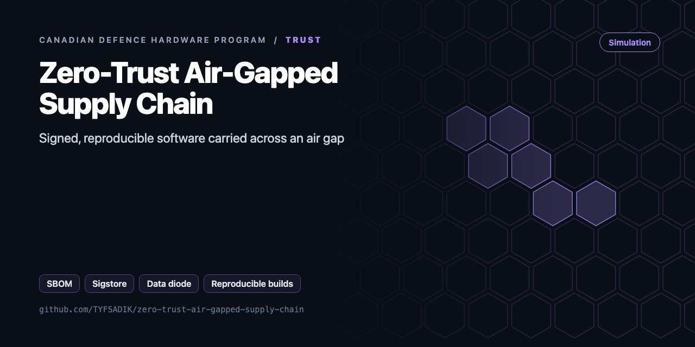
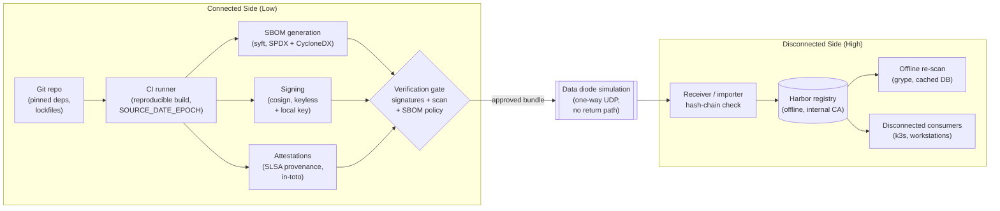

<div align="center">



# Zero-Trust Air-Gapped Software Supply Chain

**SBOM generation with syft, sigstore and cosign signing, and reproducible builds, moved across a simulated data diode into an offline Harbor registry.**

[](https://github.com/TYFSADIK/zero-trust-air-gapped-supply-chain/actions/workflows/tests.yml)   [](LICENSE) [](https://github.com/TYFSADIK/defence-hardware-program)

[Build guide](docs/project-page.md) · [How it works](#how-it-works) · [Quick start](#quick-start) · [Program hub](https://github.com/TYFSADIK/defence-hardware-program)

</div>

## Overview

Software that ends up on disconnected networks, ships, forward operating bases, classified enclaves, still has to come from somewhere. This project builds the **supply chain that gets it there safely**: every artifact is built reproducibly, inventoried with a software bill of materials (SBOM), cryptographically signed, and only then moved across a simulated one-way transfer (a data diode) into an offline registry that disconnected environments pull from.

The core problem is trust across a boundary you cannot query back through. Once an artifact crosses into the air-gapped side, the low side can never ask "did you get it intact?", so every check, hash verification, signature validation, SBOM diff, has to happen either before the transfer or entirely on the receiving side. That constraint shapes the whole design, and it is exactly the constraint real isolated networks live with.

This is a DevOps-engineering take on a defence-grade problem. I am mapping each control to published **Canadian Centre for Cyber Security** guidance, including ITSM.10.071 (Protecting your organization from software supply chain threats), ITSAP.10.070 (Cyber supply chain: an approach to assessing risk), and ITSAP.10.096 (How updates secure your device, the patch-integrity publication), so the project doubles as a practical study of how that guidance turns into pipeline code. Everything runs on open-source tooling in my homelab; there is no weapons logic, no classified data, and nothing here touches a real operational network.

## How it works



*Build, attest, verify, one-way transfer, and offline distribution stages.*

## Quick start

```bash
make test    # DSSE tamper tests, SBOM gate, diode with loss + corruption
make demo    # attest -> diode send -> recv -> verify
make repro   # reproducible-build check
```

Real output from the demo, run on simulated data:

```text
CGO_ENABLED=0 go build -trimpath -o bin/airgap ./cmd/airgap
rm -rf /tmp/ag && mkdir -p /tmp/ag/high /tmp/ag/low
head -c 500000 /dev/urandom > /tmp/ag/high/app.tar
./bin/airgap keygen -key /tmp/ag/keys/high.key
./bin/airgap attest -key /tmp/ag/keys/high.key -o /tmp/ag/high/app.att.json /tmp/ag/high/app.tar
./bin/airgap send -in /tmp/ag/high/app.tar -o /tmp/ag/frames.bin -n 2
470 frames x 2 reps
./bin/airgap recv -in /tmp/ag/frames.bin -o /tmp/ag/low/app.tar
OK 500000 bytes, repaired 0, bad crc 0
./bin/airgap verify -pub /tmp/ag/keys/high.pub -att /tmp/ag/high/app.att.json -dir /tmp/ag/low
ACCEPT: 1 subjects verified
```

## What's in this repo

| Path | Purpose |
|---|---|
| `attest/dsse.go` | in-toto v1 Statement, **DSSE envelope** with PAE encoding (the format cosign uses), trusted-key verify, digest checks |
| `attest/sbom.go` | syft wrapper (CycloneDX) and SBOM deny-list gate (e.g. `xz@5.6.1`) |
| `diode/diode.go` | One-way framing: per-frame CRC32, XOR parity per K frames, whole-file SHA-256. Repairs a lost frame with no back channel |
| `cmd/airgap` | `keygen`, `attest`, `send`, `recv`, `verify` |
| `scripts/repro-check.sh` | Builds twice in different directories and requires identical SHA-256 |
| `scripts/harbor-offline-push.sh` | Low side: push verified OCI tarballs to Harbor and `cosign verify` |

## What you need

| Category | Item | Notes |
|----|----|----|
| Hardware | Two VMs or two machines on isolated networks | The isolation must be real; do not cheat with TCP, the absence of ACKs is the whole lesson |
| Software | BuildKit, syft, cosign, trivy (low side), grype (high side), Harbor, Python for the forwarder, nftables, OPA or Conftest, Kubernetes + Terraform for the environment | All open source |
| Skills | CI/CD pipelines, container image internals, basic firewalling and networking | Comfort with digests, SBOM formats, and signature verification is the core of it |
| Accounts | None required | Keyless Sigstore signing is optional on the connected side; the air-gapped side needs no accounts at all |

## Status

- **Done**: reference service with reproducible BuildKit build (matching digests across clean builds), syft SBOM generation in both formats, cosign keyless signing in CI.
- **In progress**: in-toto provenance attestation, two-VM UDP diode simulator with chunk hash chain, Harbor deployment on the isolated VM with internal CA.
- **Next**: high-side re-verification automation, offline grype scanning with a diode-transferred vulnerability database, OPA policy gate on SBOM contents, and the full Cyber Centre guidance mapping document.

## Roadmap

- [ ] Replace XOR parity with Reed-Solomon (`klauspost/reedsolomon`) to survive bursts
- [ ] Send frames over real UDP through a one-way link (a Pi with the TX wire only, or a cut RX pair)
- [ ] Carry an offline grype vulnerability DB snapshot across, and gate on CVEs instead of a static deny list
- [ ] Two-person rule: require two trusted signatures in the envelope before ACCEPT
- [ ] SLSA provenance predicate filled from the CI run (commit, builder, materials)

## Related builds

- [Secure Robot Fleet Updates](https://github.com/TYFSADIK/secure-fleet-updates), where these signed artifacts land: measured boot and YubiKey-signed OTA on real robots.
- [DDIL-Proof DevOps](https://github.com/TYFSADIK/ddil-proof-devops), the CI/CD system that produces the signed artifacts this pipeline verifies.
- [Decision Black Box](https://github.com/TYFSADIK/decision-black-box), tamper-evident logging that records what the trusted software decided.

## Learn more

The full build guide, with step-by-step instructions, wiring, troubleshooting and lessons learned, is in [docs/project-page.md](docs/project-page.md). It is also published at [tyfsadik.org](https://tyfsadik.org/work/defence/zero-trust-air-gapped-supply-chain.html).

## License

[MIT](LICENSE). Built by [Taki Sadik](https://tyfsadik.org) as part of the self-funded [Canadian Defence Hardware Program](https://github.com/TYFSADIK/defence-hardware-program).
